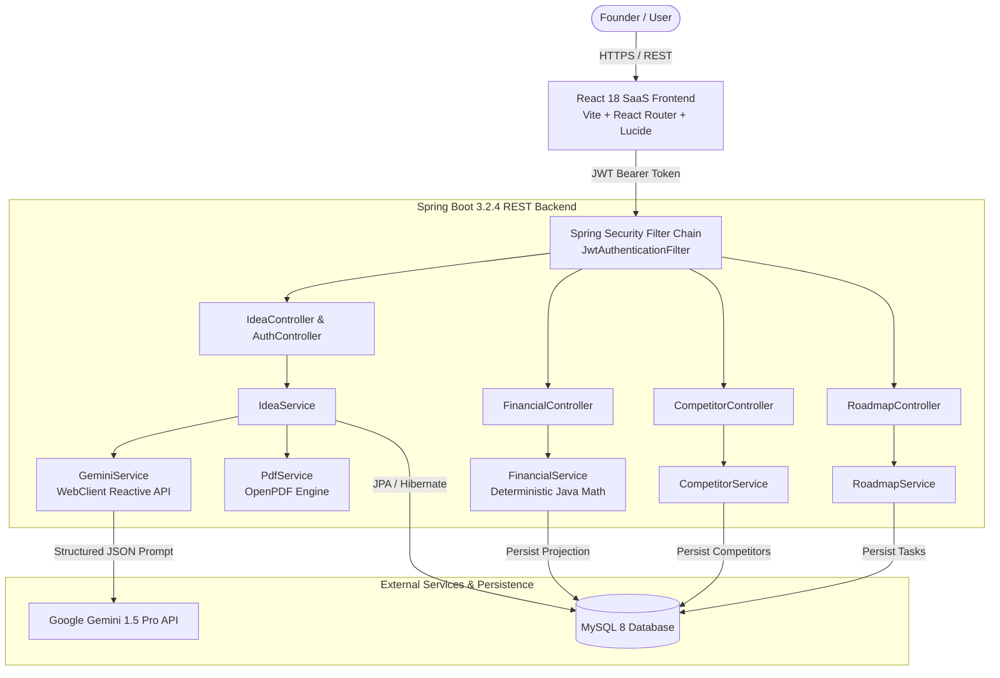

# 🚀 AI Startup Idea Validator

> A production-oriented, full-stack intelligence platform that transforms raw entrepreneurial concepts into structured, evaluated business plans using Google Gemini AI, deterministic financial modeling, and executive PDF reporting.

[](https://www.oracle.com/java/)
[](https://spring.io/projects/spring-boot)
[](https://react.dev/)
[](https://www.mysql.com/)
[](LICENSE)

---

## 📑 Table of Contents

- [Overview](#-overview)
- [Problem Statement](#-problem-statement)
- [Key Features](#-key-features)
- [Architecture & Data Flow](#-architecture--data-flow)
- [Technology Stack](#-technology-stack)
- [Project Directory Structure](#-project-directory-structure)
- [Prerequisites](#-prerequisites)
- [Environment Variables](#-environment-variables)
- [Database Setup](#-database-setup)
- [Running the Backend](#-running-the-backend)
- [Running the Frontend](#-running-the-frontend)
- [API Endpoints Reference](#-api-endpoints-reference)
- [Testing & Quality Assurance](#-testing--quality-assurance)
- [AI Methodology & Transparency](#-ai-methodology--transparency)
- [Deployment Guide](#-deployment-guide)
- [Limitations & Future Enhancements](#-limitations--future-enhancements)

---

## 🌟 Overview

The **AI Startup Idea Validator** provides early-stage entrepreneurs, venture evaluators, and product managers with an objective, multi-dimensional assessment of new startup concepts before committing capital.

Unlike simple chatbots, this application enforces **structured schema output**, calculates financial unit economics through **deterministic Java backend algorithms**, evaluates competitive positioning, maintains persistent idea history with **JWT user authentication**, and compiles **investor-ready PDF reports** with OpenPDF.

---

## 🎯 Problem Statement

Over 90% of early-stage startups fail, often because founders build solutions without validating customer problem severity, market dynamics, unit margins, or direct competition. 

Existing validation approaches are either:
1. **Generic AI chats**: Unstructured, hallucinating wild projections and fabricating ungrounded statistics.
2. **Expensive consultancy**: Prohibitive for indie founders and bootstrappers.
3. **Manual spreadsheets**: Prone to formula errors, fragmented workflows, and zero actionable guidance.

**AI Startup Idea Validator** solves this by combining AI qualitative evaluation with strict quantitative feasibility mathematics.

---

## ✨ Key Features

### 1. Multi-Dimensional Startup Evaluation
- **Indicative Startup Readiness Score (0-100)**: Transparent qualitative score based on Problem Clarity, Market Size, Execution Feasibility, and Monetization Structure (explicitly distinguished from predictive success probability).
- **6 Core Evaluation Dimensions**: Individual scores, findings, identified gaps, and recommended actions.
- **Full SWOT Matrix**: Distinct cards for internal Strengths, internal Weaknesses, external Opportunities, and external Market Threats.
- **Strategic Risk Matrix**: Severity badges (Critical, High, Medium, Low), impact breakdowns, and proactive mitigations.
- **Actionable Recommendations**: Prioritized steps with suggested timeframes and next actions.

### 2. Deterministic Financial Feasibility Calculator
- Uses strict Java mathematics (no AI calculations) for financial precision.
- **Unit Economics**: Variable costs, contribution margin per unit.
- **Break-Even Analysis**: Break-even volume in units (rounded up) and required break-even revenue.
- **Operating Margins**: Distinguishes operating margin from net profit.
- **Capital Runway**: Estimated runway buffer based on upfront investment and monthly burn rate.

### 3. Competitor Intelligence & Differentiation
- Identifies incumbent alternatives, agile challengers, and manual status-quo workarounds.
- Outlines competitor strengths, limitations, and strategic differentiation opportunities.
- Labeled transparently as an AI-assisted preliminary assessment requiring verification.

### 4. Actionable 5-Phase Startup Roadmap
- Tracks tasks across 5 distinct phases:
  - *Phase 1: Validate Problem*
  - *Phase 2: Validate Solution*
  - *Phase 3: Validate Business Model*
  - *Phase 4: Build & Launch*
  - *Phase 5: Measure & Improve*
- Real-time status toggling (`Pending`, `In Progress`, `Completed`), progress bars, and custom task creation.

### 5. Secure JWT Authentication & Portfolio Management
- BCrypt password hashing.
- User-scoped idea history and metrics isolation.
- Stateless REST session security.

### 6. Executive PDF Export
- Generates styled, multi-page PDF documents using OpenPDF.
- Includes cover banner, score badges, SWOT matrix, risks, evaluation dimensions, and financial projections.

---

## 🏗️ Architecture & Data Flow



---

## 💻 Technology Stack

### Backend
- **Language**: Java 21 (LTS)
- **Framework**: Spring Boot 3.2.4
- **Security**: Spring Security 6 with JWT (`jjwt` 0.12.5) & BCrypt
- **ORM / Persistence**: Spring Data JPA, Hibernate 6, Hypersistence Utils (JSON column mapping)
- **Document Processing**: OpenPDF 1.3.32
- **Testing**: JUnit 5, Mockito
- **Build Tool**: Apache Maven 3.9+

### Frontend
- **Library**: React 18
- **Language**: JavaScript (ES2022)
- **Tooling**: Vite 5
- **Routing**: React Router DOM 6
- **Icons**: Lucide React
- **Design System**: Custom CSS with standardized 4px design tokens and Inter typography

### Database
- **Engine**: MySQL 8.0+
- **In-Memory Alternative**: H2 database included for lightweight deployment

---

## 📂 Project Directory Structure

```text
AI-Startup-Idea-Validator/
├── .env.example                     # Environment variables template
├── README.md                        # Primary project documentation
├── database/
│   └── schema.sql                   # Relational MySQL DDL schema and indexes
├── backend/
│   ├── pom.xml                      # Maven dependencies (Java 21, Spring Boot, Security, JWT)
│   ├── src/
│   │   ├── main/
│   │   │   ├── java/com/startup/validator/
│   │   │   │   ├── config/          # Security, JWT, CORS, WebClient configuration
│   │   │   │   ├── controller/      # REST API controllers (Auth, Ideas, Financial, Competitors, Roadmap)
│   │   │   │   ├── dto/             # Validated request and response DTOs
│   │   │   │   ├── entity/          # JPA entities (User, StartupIdea, AnalysisReport, etc.)
│   │   │   │   ├── exception/       # Centralized exception handling
│   │   │   │   ├── repository/      # Spring Data JPA repositories
│   │   │   │   └── service/         # Business logic (Gemini, Financial, PDF, Roadmap, Auth)
│   │   │   └── resources/
│   │   │       └── application.yml  # Externalized configuration
│   │   └── test/java/com/startup/validator/
│   │       └── service/             # Unit tests (Financial formulas, Gemini fallback, IdeaService)
├── frontend/                        # Modern React 18 SPA (Vite)
│   ├── index.html                   # HTML entry point with Inter font
│   ├── package.json                 # Frontend dependencies
│   ├── vite.config.js               # Vite build configuration
│   └── src/
│       ├── App.css                  # SaaS design system tokens
│       ├── App.jsx                  # Main application routes & guards
│       ├── api/api.js               # Fetch wrapper with Bearer token & PDF downloader
│       ├── context/AuthContext.jsx  # Authentication state & session persistence
│       ├── components/              # Reusable UI components (ScoreCircle, SwotCard, RiskTable, Layout)
│       └── pages/                   # Landing, Login, Register, Dashboard, Analyze, Results, etc.
└── frontend-legacy/                 # Original vanilla JS implementation backup
```

---

## 📋 Prerequisites

1. **Java JDK 21+** installed (`java -version`)
2. **Apache Maven 3.8+** installed (`mvn -version`)
3. **Node.js 18+** & npm installed (`node -v`)
4. **MySQL Server 8.0+** running locally or in cloud
5. **Google Gemini API Key** (from [Google AI Studio](https://aistudio.google.com/))

---

## ⚙️ Environment Variables

Create a `.env` file in the project root or configure your system environment:

| Variable | Default Value | Description |
| :--- | :--- | :--- |
| `DB_HOST` | `localhost` | MySQL server host |
| `DB_PORT` | `3306` | MySQL server port |
| `DB_NAME` | `startup_validator` | Database name |
| `DB_USERNAME` | `root` | Database username |
| `DB_PASSWORD` | *(empty)* | Database password |
| `GEMINI_API_KEY` | *(empty)* | Google Gemini 1.5 Pro API key |
| `JWT_SECRET` | *(development default)* | Secret key (min 32 chars) for signing JWTs |
| `SERVER_PORT` | `8080` | Spring Boot backend port |
| `VITE_API_URL` | `http://localhost:8080/api` | Frontend API base URL |

*(Note: If `GEMINI_API_KEY` is not provided, the backend seamlessly switches to an intelligent deterministic fallback heuristic engine without crashing).*

---

## 🗄️ Database Setup

1. Open your MySQL client or workbench.
2. Run the SQL script located in `database/schema.sql`:
   ```sql
   SOURCE database/schema.sql;
   ```
3. Hibernate `ddl-auto: update` will also automatically create or synchronize missing columns and tables upon backend startup.

---

## 🏃 Running the Backend

1. Navigate to the `backend` directory:
   ```bash
   cd backend
   ```
2. Build the project and run test suites:
   ```bash
   mvn clean test
   ```
3. Launch the Spring Boot application:
   ```bash
   mvn spring-boot:run
   ```
   The backend will start at `http://localhost:8080`.

---

## 💻 Running the Frontend

1. Navigate to the `frontend` directory:
   ```bash
   cd frontend
   ```
2. Install dependencies (first time only):
   ```bash
   npm install
   ```
3. Start the Vite development server:
   ```bash
   npm run dev
   ```
   The frontend will be available at `http://localhost:5173`.

---

## 🔌 API Endpoints Reference

### Authentication
- `POST /api/auth/register` — Create a new founder account
- `POST /api/auth/login` — Sign in and receive JWT token
- `GET /api/auth/me` — Retrieve current authenticated session info

### Startup Ideas & Analysis
- `POST /api/ideas/analyze` — Submit startup idea for structured AI evaluation
- `GET /api/ideas` — Retrieve paginated list of user's saved ideas
- `GET /api/ideas/{id}` — Fetch complete startup idea detail with reports
- `DELETE /api/ideas/{id}` — Remove an idea from portfolio
- `GET /api/ideas/history` — Backward-compatible paginated history

### Financial Feasibility
- `POST /api/ideas/{id}/financial-projection` — Calculate deterministic unit economics & break-even metrics
- `GET /api/ideas/{id}/financial-projection` — Retrieve latest financial projection

### Competitor Intelligence
- `POST /api/ideas/{id}/competitors/analyze` — Generate competitive matrix & differentiation
- `GET /api/ideas/{id}/competitors` — Retrieve saved competitor profiles

### Startup Roadmap
- `GET /api/ideas/{id}/roadmap` — Retrieve phased roadmap tasks
- `POST /api/ideas/{id}/roadmap/tasks` — Add a custom task to a roadmap phase
- `PUT /api/roadmap/tasks/{taskId}` — Update task status (`PENDING`, `IN_PROGRESS`, `COMPLETED`)
- `DELETE /api/roadmap/tasks/{taskId}` — Remove a roadmap task

### Reports & PDF Export
- `GET /api/reports/{id}` — Retrieve structured report data
- `GET /api/reports/{id}/pdf` — Download generated PDF report

---

## 🧪 Testing & Quality Assurance

Unit and integration tests are executed with JUnit 5 and Mockito:

```bash
cd backend
mvn test
```

### Test Coverage Highlights:
- **`FinancialServiceTest`**: Validates deterministic profit calculations, positive contribution margin handling, break-even unit round-up logic (`Math.ceil`), negative input rejection, and division-by-zero safeguards.
- **`GeminiServiceTest`**: Tests structured JSON parsing, fallback heuristic generation, and score normalization (10-100).
- **`IdeaServiceTest`**: Tests end-to-end idea processing, persistence, and authorization isolation between users.

---

## 🔍 AI Methodology & Transparency

- **No Hallucinated Statistics**: The system does not fabricate verified market sizes or financial revenue claims. Unverified market statements are clearly labeled for independent founder verification.
- **Readiness Score vs. Probability**: The score is explicitly labeled as a **Startup Readiness Score (XX/100)** based on qualitative business model completeness, never as an empirical "guarantee of commercial success."
- **Deterministic Financials**: Projections are strictly calculated using standard accounting formulas in Java, ensuring mathematically sound numbers.

---

## 🌐 Deployment Guide

### Frontend Deployment (Vercel)
1. Set the root directory in Vercel to `frontend`.
2. Configure the build command: `npm run build`.
3. Set the output directory: `dist`.
4. Add environment variable: `VITE_API_URL=https://your-backend-domain.com/api`.

### Backend Deployment (Render / Railway / AWS EC2)
1. Deploy as a standard Java application with JDK 21.
2. Build command: `mvn clean package -DskipTests`.
3. Start command: `java -jar target/validator-0.0.1-SNAPSHOT.jar`.
4. Configure production environment variables (`DB_HOST`, `DB_PASSWORD`, `GEMINI_API_KEY`, `JWT_SECRET`).
5. Ensure CORS allowed origins include your deployed frontend domain.

---

## 🔮 Limitations & Future Enhancements

- **Live Web Research Integration**: Currently, competitor intelligence relies on preliminary model heuristics; future versions can incorporate Google Search Grounding for live citation verification.
- **Multi-Currency Support**: Currently defaults to USD; future iterations will support regional currency selection.
- **Investor Pitch Deck Generator**: Direct export into editable `.pptx` presentations based on the evaluation dimensions.

---

## 👤 Author & Portfolio Context

Developed and enhanced as a full-stack portfolio project demonstrating:
- Enterprise Java 21 & Spring Boot 3 architecture
- Secure stateless JWT authentication
- Reactive AI model integration
- Deterministic financial computation
- Responsive modern SaaS UI/UX in React 18

**Repository**: [github.com/Pavani3939/Ai-Startup-IdeaValidator](https://github.com/Pavani3939/Ai-Startup-IdeaValidator)
